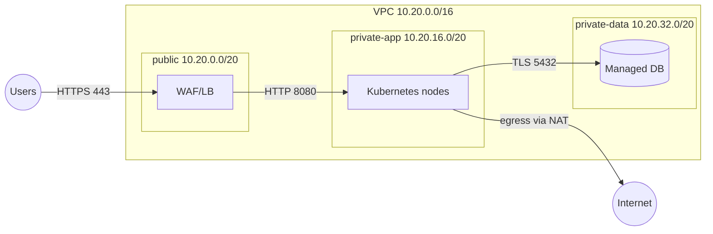

# Infrastructure and network design

Output goes into the GitOps repo, so design, diagram and code are reviewed together:
```
docs/architecture/<system>/README.md      decisions, assumptions, WAF review
docs/architecture/<system>/overview.mmd   context/components (Mermaid)
docs/architecture/<system>/network.d2     network: CIDRs, zones, flows (D2 or Mermaid)
```

## Steps
1. **Requirements:** workload, regions, environments, RTO/RPO, compliance, expected load, budget, team skills. Ask only for what changes the design.
2. **Baseline per cloud**: pick the landing-zone pattern first (accounts/subscriptions/projects, hub-spoke or single VPC).
3. **Network plan**:
   - Non-overlapping CIDRs across clouds, environments and on-prem. Reserve room for peering and VPN.
   - Subnets per tier (public / private app / private data), one per AZ/zone.
   - Egress through NAT or a firewall. Ingress through LB/WAF only.
   - Private endpoints for managed services. Name the DNS strategy.
   - Kubernetes: pod/service CIDRs don't overlap VPCs; pick the CNI mode deliberately.
4. **Diagrams**: overview plus network. Label every edge with protocol and port, and mark trust boundaries.
5. **WAF review**: one line per pillar (operational excellence, security, reliability, performance, cost, sustainability), with the main risk and its mitigation.
6. **Hand off to code**: Crossplane (`iac-crossplane`) for continuously reconciled resources on AWS/Azure/GCP, Terraform/OpenTofu (`iac-terraform`) elsewhere or when the team prefers it.

## Service map
| Need | AWS | Azure | GCP | Hetzner | DigitalOcean | Alibaba |
|---|---|---|---|---|---|---|
| Network | VPC | VNet | VPC (global) | Network + subnets | VPC | VPC + vSwitch |
| Kubernetes | EKS | AKS | GKE | k3s/Talos/kubeadm on Cloud servers (Ansible) | DOKS | ACK |
| LB | ALB/NLB | App GW / LB | Cloud LB | Load Balancer | Load Balancer | SLB/ALB |
| Firewall | SG + NACL / Network Firewall | NSG / Azure Firewall | VPC firewall rules | Firewalls | Cloud Firewalls | Security groups |
| Private DNS | Route 53 private | Private DNS zones | Cloud DNS private | (self-managed) | (self-managed) | PrivateZone |
| Object storage | S3 | Blob | GCS | Object Storage (S3 API) | Spaces (S3 API) | OSS |
| Managed DB | RDS/Aurora | Azure DB | Cloud SQL | (self-managed) | Managed DB | ApsaraDB RDS |
| Secrets | Secrets Manager | Key Vault | Secret Manager | (Vault) | (Vault) | KMS Secrets Manager |
| Logs | CloudWatch | Log Analytics | Cloud Logging | (Loki) | (Loki) | SLS |
| Cost data | Cost Explorer / CUR | Cost Management | Billing export (BigQuery) | invoices | billing API | BSS OpenAPI |

## Diagram templates

D2 suits larger network maps: `vpc: {pub: {...}; app: {...}}` with `app.k8s -> data.db: "5432/TLS"`.

Rules: no credentials, account IDs or public IPs of prod systems in diagrams unless the user asks.
